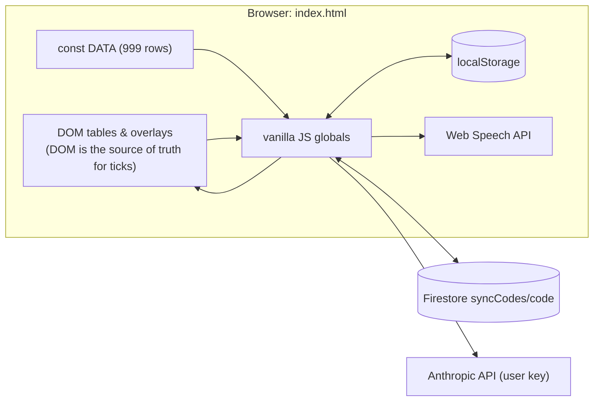
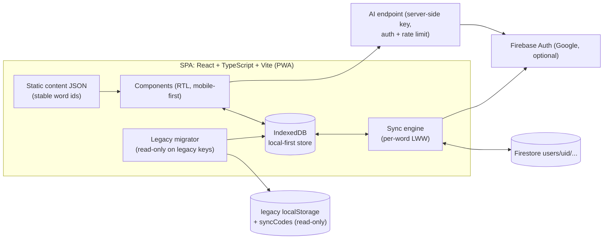

# Architecture

## Current (legacy, in production)

A single static file served by GitHub Pages (branch `main`, path `/`):

```
index.html     CSS (1–1124) · markup (1131–1347) · DATA (1357–2821) · logic (2823–4380)
sw.js          network-first service worker (install currently fails, see BASELINE V1)
manifest.json  PWA manifest
icon-512.png   app icon
```



Details: [`DATA_CONTRACTS.md`](DATA_CONTRACTS.md) and [`BASELINE.md`](BASELINE.md).

## Target (proposed, see ADR 0001)



## Repository layout

Current (Phase 1):

```
index.html, sw.js, manifest.json, icon-512.png   legacy app (unchanged)
package.json                                      scripts only, no dependencies
scripts/lib/legacy-source.mjs                     read-only extraction helpers
scripts/extract-baseline.mjs                      → tests/fixtures/baseline/*
scripts/extract-legacy-index-maps.mjs             → tests/fixtures/legacy/*
tests/baseline/*.test.mjs                         baseline, contract, known-defect tests
docs/                                             this documentation, ADRs
.github/workflows/ci.yml                          CI (tests only, no deploy)
```

Planned (Phase 2+): `src/`, `src/content/`, `functions/` or `server/`,
`firestore.rules`, `e2e/`. See ADR 0001 §3.6.
