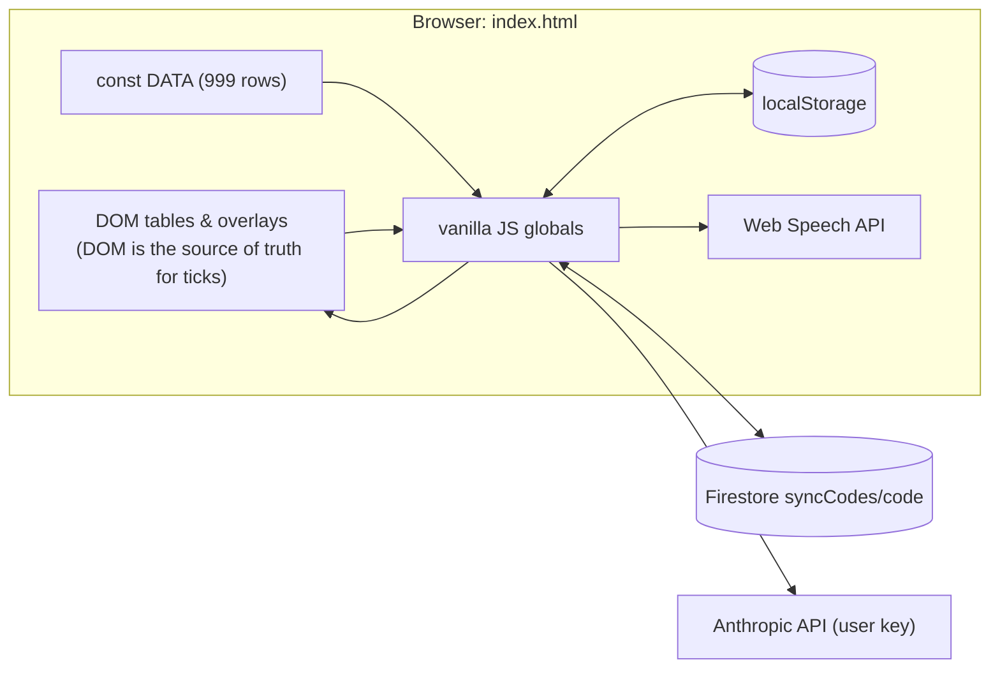
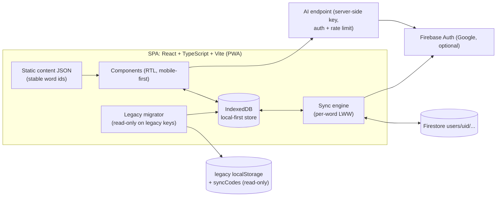
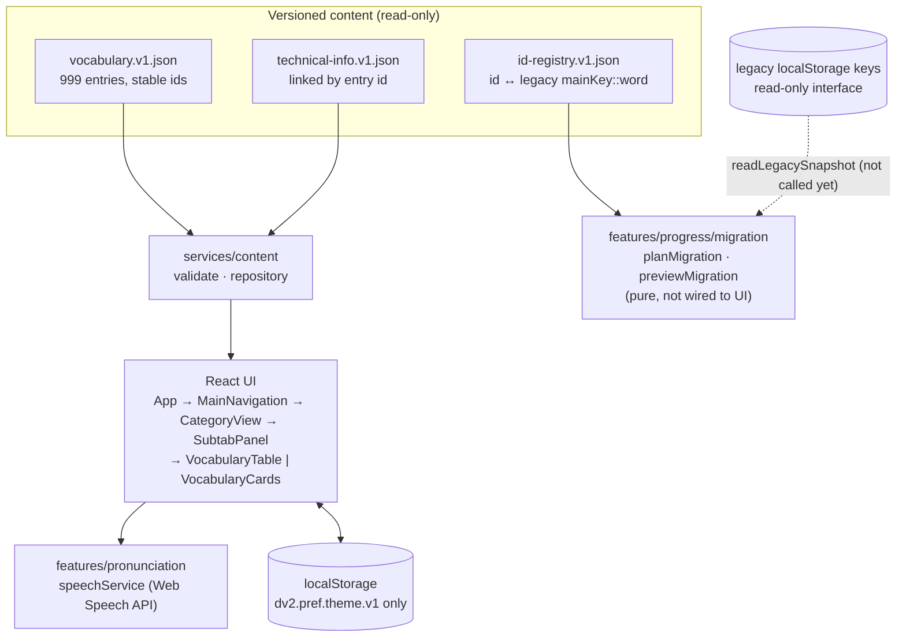
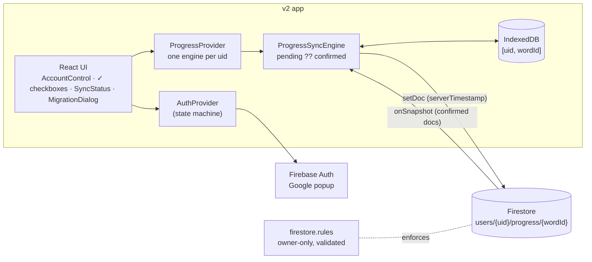

# Architecture

## Current (legacy, in production)

A single static file served by GitHub Pages (branch `main`, path `/`):

```
index.html     CSS (1–1124) · markup (1131–1347) · DATA (1357–2821) · logic (2823–4380)
sw.js          network-first service worker (install currently fails, see BASELINE V1)
manifest.json  PWA manifest
icon-512.png   app icon
```



Details: [`DATA_CONTRACTS.md`](DATA_CONTRACTS.md) and [`BASELINE.md`](BASELINE.md).

## Target (proposed, see ADR 0001)



## Repository layout

Current (Phase 1):

```
index.html, sw.js, manifest.json, icon-512.png   legacy app (unchanged)
package.json                                      scripts only, no dependencies
scripts/lib/legacy-source.mjs                     read-only extraction helpers
scripts/extract-baseline.mjs                      → tests/fixtures/baseline/*
scripts/extract-legacy-index-maps.mjs             → tests/fixtures/legacy/*
tests/baseline/*.test.mjs                         baseline, contract, known-defect tests
docs/                                             this documentation, ADRs
.github/workflows/ci.yml                          CI (tests only, no deploy)
```

Phase 2 adds the isolated `v2/` application (not deployed):

```
v2/src/app/                      App shell
v2/src/components/               Header, TabList (ARIA tabs), ThemeToggle, EmptyState
v2/src/features/vocabulary/      navigation state, table/cards, badges, technical info
v2/src/features/pronunciation/   Web Speech service + provider + button
v2/src/features/progress/migration/  read-only legacy migration plan/preview (pure logic)
v2/src/data/vocabulary/          vocabulary.v1.json, technical-info.v1.json, id-registry.v1.json
v2/src/data/legacy/              dvok5-index-maps.v1.json
v2/src/models/, services/, hooks/, styles/
v2/tests/unit/, v2/tests/e2e/
```

Phase 3 adds `v2/src/features/auth/` (Google sign-in), `v2/src/features/account/` (header account
menu, sync status), `v2/src/features/progress/` (IndexedDB store, sync engine, Firestore adapters,
migration workflow), `v2/firestore.rules`, `v2/firebase.json` and emulator tests
(`v2/tests/emulator/`, `v2/tests/e2e-emulator/`). See ADR 0004 and `docs/SYNC_DESIGN.md`.

Phase 4A adds `v2/src/features/review/` (flashcards: pure deck/session/outcome logic, a
device-local review log in IndexedDB v2, and the «🔄 مرور» tab). See `docs/REVIEW_DESIGN.md`.

Phase 4B adds `v2/src/features/shadowing/` (pure step plan, weighted queue and a playback engine
over the shared speech service, device-local exposure in IndexedDB v3, the «🗣 تلفظ» tab) and
`v2/src/styles/practice.css` (shared practice UI). See `docs/SHADOWING_DESIGN.md`.

Phase 4C adds the four main sections with hash routes (`v2/src/app/sections.ts`,
`components/PrimaryNav`), vocabulary search and filters (`features/search/`), the learning dashboard
(`features/dashboard/`), an offline banner and accessibility/contrast fixes. See
`docs/UI_UX_PHASE4C.md`.

Still planned: production deployment, the server-side AI endpoint, cloud-synced review/practice
state (proposal in `REVIEW_DESIGN.md` §6) and a PWA service worker.

## v2 architecture (Phase 2)



Key rules:

- The UI holds navigation state in React. It never reads the DOM to learn about vocabulary.
- All text is rendered as React text nodes. Raw HTML APIs are banned, and a test enforces it.
- Content is validated at startup (`ContentValidationError`). Ids come from the content and are
  never computed at runtime.
- v2 writes exactly one browser key (`dv2.pref.theme.v1`). Legacy keys are never written.

## v2 architecture (Phase 3: identity and progress)


