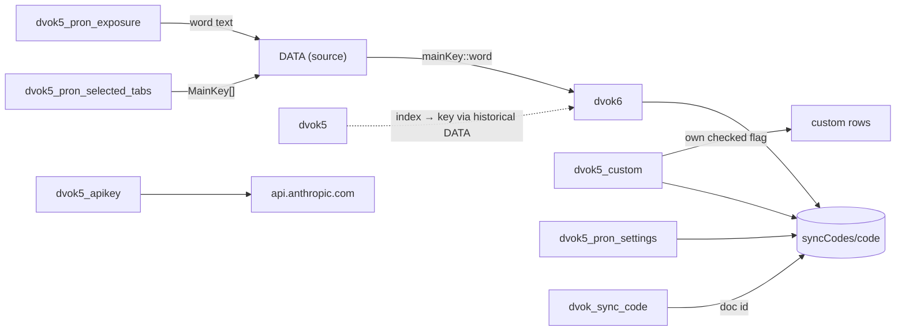

# Legacy Data Contracts

Status: documents the legacy app as of commit `6763003` (2026-09-15).
Line numbers refer to `index.html` at that commit. The contracts are guarded by
`tests/baseline/storage-contract.test.mjs`.

All persistence is browser `localStorage` on the app's origin
(`https://samradfar.github.io`, path `/Deutsch-Vokabular/`). Firestore is used only
for the optional six-digit-code sync. There is no user identity.

> Naming note: the `dvok5_*` keys are **not** related to the legacy `dvok5` progress
> key. They are simply named after the app version that introduced them.

## 1. Built-in vocabulary (read-only, in source)

`const DATA` (`index.html:1357–2821`), extracted verbatim to
`tests/fixtures/baseline/vocabulary.json`.

```ts
type Data = Record<MainKey, {
  label: string;           // e.g. "🏛 Architecture"
  theme: MainKey;          // always equal to the key (asserted)
  tabs: Array<{
    id: string;            // unique across all categories (asserted)
    icon: string;
    label: string;
    fa: string;            // Persian subtitle, may be '' (all Bauphysik tabs)
    groups: Array<{ label: string; rows: Row[] }>;
  }>;
}>;
type MainKey = 'arch' | 'acad' | 'bautechnik' | 'bauphysik' | 'fitness' | 'anatomie' | 'dreame';
// Row fields are always 6 non-empty, trimmed strings (asserted):
type Row = [word: string, type: 'n' | 'v' | 'a' | 'au' | 'x', fa: string,
            example: string, exampleFa: string, pronunciationFa: string];
```

- The word string includes the article (`die Außenwand`). There are no separate
  gender, plural, level or id fields.
- `BAUTECHNIK_INFO` (`index.html:3411`) is keyed by the exact word string:
  `Record<word, { formula: { lbl, val } | null, kv: Array<{ key, val, cls }> }>`.
  The drawer is only shown for rows rendered inside `bautechnik` (`index.html:2888`).

## 2. Progress identity: `mainKey::word`

`rowKey(row)` (`index.html:3368`):

```js
mainKey + '::' + wordCell.textContent.trim()
```

- `mainKey` comes from the enclosing panel id `main-<mainKey>`.
- The word cell is rendered through `innerHTML`, so the key equals
  `mainKey + '::' + word` only while words contain no `<`, `>` or `&`. This holds
  today (asserted).
- **Subtab and group are not part of the key.** A word that occurs twice in one
  category shares one key. There are 5 such collisions, so there are 994 unique keys
  for 999 rows (see `docs/DATA_QUALITY.md`, DQ-1).
- The same word in two different categories gets two independent keys (37 words).
- Renaming a word or a category key orphans its saved progress.

## 3. localStorage keys

| Key | Shape | Written by | Read by | Synced |
|---|---|---|---|---|
| `dvok6` | `Record<progressKey, true>` (only checked rows; never `false`) | `save()` `:3375`, `syncApplyRemoteData()` `:3087` | `loadState()` `:3387`, `syncCollectLocalData()` `:3075`, `checkLegacyProgressData()` `:2998` | ✅ as `checked` |
| `dvok5` | `Record<"<index>", boolean>`: legacy, index-based (§4) | not written any more; removed by `resetAll()` `:3405` | `checkLegacyProgressData()` (warning banner only) | ❌ |
| `dvok5_custom` | `CustomWord[]` (§5) | `cwSet()` `:3490`, `syncApplyRemoteData()` `:3100` | `cwAll()` `:3489` | ✅ as `custom` |
| `dvok5_pron_settings` | `{ repeat: 'once'\|'twice'\|'twotwo', pause: number /*1–8 s*/, rate: 0.55\|0.85\|1.2, shadow: boolean }` | `pronSaveSettings()` `:3801`, `syncApplyRemoteData()` `:3106` | `pronLoadSettings()` `:3792` | ✅ as `pron` |
| `dvok5_pron_exposure` | `Record<wordText, number>`: times played in pronunciation mode, keyed by **word text only** | `pronBumpExposure()` `:3740` | `pronBuildQueue()` `:3857` | ❌ |
| `dvok5_pron_selected_tabs` | `MainKey[]` | `pronToggleTab()` `:3784` | `pronRenderTabSelect()` `:3761` | ❌ |
| `dvok_sync_code` | six-digit string | `syncSetLocalCode()` `:3067` | `syncGetLocalCode()` `:3064` | (is the address) |
| `dvok_theme` | `'light' \| 'dark'` | `toggleTheme()` `:3259` | `initTheme()` `:3266` | ❌ by design |
| `dvok5_apikey` | Anthropic API key, plain text | `awSave()` `:3667`; removed on HTTP 401 | `cwGenerate()` `:3571` | ❌ (must never be synced or migrated) |

### Lifecycle behaviours that matter for migration

1. **`save()` rebuilds `dvok6` from the DOM.** Keys whose rows no longer exist
   (orphans) survive in storage only until the next checkbox change, then they are
   dropped. The latest commit removed 39 Bautechnik words (§4), so their ticks
   may still sit in `dvok6` on devices that have not ticked anything since.
2. `resetAll()` removes `dvok6` and `dvok5` but leaves custom words'
   `checked` flags, exposure, and the remote sync document untouched.
3. `syncApplyRemoteData()` **replaces** `dvok6`, `dvok5_custom` and
   `dvok5_pron_settings` with the remote document. It does not merge.
4. Exposure is keyed by word text, so the same word in two categories shares one
   counter. Custom words also add to it.

## 4. Legacy `dvok5` progress (index-based)

Versions up to `b45ca12` (2026-09-07) saved:

```js
document.querySelectorAll('.vchk:not(.cchk)').forEach((c, i) => { s[i] = c.checked; });
localStorage.setItem('dvok5', JSON.stringify(s));
```

That is one boolean per built-in checkbox, keyed by DOM position. The position
depends on the `DATA` of the version that wrote it. `dvok6` (word-based) replaced
it in `5a55a4b`, and no automatic conversion was ever shipped. Only a warning banner
appears when `dvok5` has checks and `dvok6` is empty.

Every version wrote an entry for every checkbox, so **the number of entries
identifies the version**. `tests/fixtures/legacy/dvok5-index-maps.json` holds
the index → progress-key map for each distinct historical vocabulary:

| Entries in `dvok5` | Version(s) | Distinct keys | Keys not in the current baseline |
|---|---|---|---|
| 490 | `e3768cb` (2026-05-13) | 487 | 0 |
| 733 | `155cfaf`, `4f415b2`, `98420c6` (2026-06, identical vocabulary) | 728 | 39 |
| 822 | `b45ca12` (2026-09-07) | 817 | 39 |

The 39 missing keys are the former `bautechnik/bauphysik` subtab, which was
removed in `6763003` when the separate Bauphysik category was introduced. 7 of
those word strings still exist in the `arch` category. The rest no longer exist
anywhere.

## 5. Custom words (`dvok5_custom`)

```ts
type CustomWord = {
  id: string;              // 'cw' + Date.now(); stable, unique per device
  main: MainKey; tab: string;   // placement; if the tab no longer exists the word is not rendered
  word: string;            // replaced by the AI-normalised form (article added) when generated
  sentence: string;        // optional context typed by the user
  type: 'n' | 'v' | 'a' | 'x';
  fa: string; ex: string; exFa: string; pr: string;   // empty while pending
  status: 'pending' | 'ready';
  checked: boolean;        // custom words keep their own learned flag (not in dvok6)
};
```

All fields are rendered with `innerHTML` **without escaping**. Treat every stored
value as untrusted input.

## 6. Firestore sync document

- Collection `syncCodes`, document id = the six-digit code
  (`String(Math.floor(100000 + Math.random() * 900000))`).
- Payload: `{ checked: <dvok6>, custom: <dvok5_custom>, pron: <dvok5_pron_settings>, updatedAt: serverTimestamp() }`.
- Written with `set(…, { merge: true })`, debounced by 1.2 s (`syncPush()` `:3119`).
  The three fields are whole blobs, so the last writer wins per blob.
- Read with `onSnapshot` (`syncStartListening()` `:3138`). Applying a snapshot
  replaces local data (§3, point 3).
- No authentication. The Security Rules are **not in this repository and have not been
  verified**.
- The Firebase web client config is in `index.html` (`firebaseConfig`, `:3028`).
  It is a public identifier, not a secret.

## 7. Relationships


